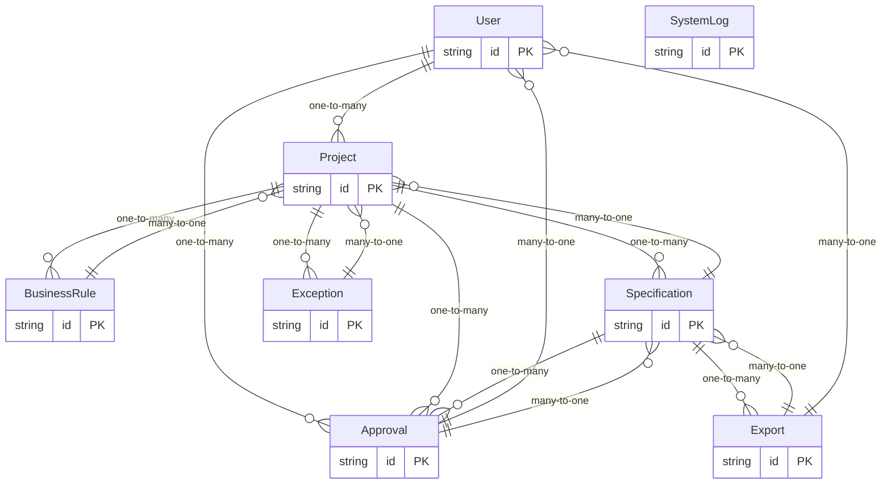

# Engineering Package — AI Software Engineer

> Implementation-ready specification produced by the AI Software Engineer on Wed Oct 28 2026. Readiness gate passed; every requirement below is client-approved with traceable provenance.

## 01 — Product Definition

### Original idea

> The problem i want to solve is not writing code. It is preventing software from being built incorrectly because of incomplete analysis, missing requirements, misunderstood business rules, or poor architecture — and then having to rebuild it from scratch.
> 
> ### 1\. The Product We Want to Build
> 
> ### AI Software Engineer
> 
> From an idea to an implementation-ready engineering package
> 
> Understand the Client
> 
> Even when they cannot articulate their idea
> 
> Analyze the Problem
> 
> Discover gaps and contradictions
> 
> Design the System
> 
> Data, processes, and relationships
> 
> Prepare for Implementation
> 
> Documents and testable tasks
> 
> Final deliverable
> 
> ### Software Engineering Package
> 
> Approved requirements + architecture + database design + API contracts + UI specifications + implementation plan + tests
> 
> This platform does not need access to my existing projects or code repositories. It acts as a virtual software engineer who sits with a client, understands their needs, analyzes the system, and prepares the complete project specification from scratch.
> 
> ### 2\. How Should the Virtual Software Engineer Work?
> 
> It must not treat the user as a programmer. It should treat them as someone who has a problem and wants a software solution.
> 
> Imagine a user says:
> 
> > I want an application that connects merchants with suppliers and helps merchants obtain the best prices.
> 
> This sentence is nowhere near sufficient to build an application. The virtual engineer must not immediately create database tables or choose Laravel, React, or another technology. It must first understand the actual business.
> 
> ### 01
> 
> Understand the Problem and Objective
> 
> What problem does the merchant face today? How do they currently solve it? Who is affected? What outcome do they want to achieve?
> 
> ### 02
> 
> Discover the Real Business Workflow
> 
> How does a merchant register? How do they find a supplier? How do they request a quotation? What happens if a supplier rejects the request, changes the price, or does not respond? Who makes each decision?
> 
> ### 03
> 
> Discover Hidden Requirements
> 
> Ask about permissions, exceptions, notifications, payments, cancellations, errors, modifications, reporting, privacy, and other scenarios that users may not think to mention.
> 
> ### 04
> 
> Transform the Understanding into a System
> 
> Define users and roles, inputs and outputs, processes, business rules, data entities, relationships, interfaces, and integrations.
> 
> ### 05
> 
> Review and Approve the Analysis
> 
> Present the system understanding to the client in plain language. Let them correct misunderstandings and approve decisions before proceeding to the final design.
> 
> ### 06
> 
> Deliver an Engineering Package
> 
> Convert the approved specifications into interconnected documents, dependency-ordered implementation tasks, acceptance criteria, and tests that demonstrate whether each task is complete.
> 
> ### 3\. The Core Engines Inside the Platform
> 
> I recommend building specialized engines that work together through one unified workflow, rather than creating a collection of disconnected tools.
> 
> | Engine                                  | Primary responsibility                                                                                         | Output                                      |
> | --------------------------------------- | -------------------------------------------------------------------------------------------------------------- | ------------------------------------------- |
> | 1. Idea Understanding Engine            | Understand natural language, including dialects, and translate it into precise Arabic and English descriptions | Unified problem and idea definition         |
> | 2. Requirements Discovery Engine        | Conduct interactive interviews and identify missing information                                                | Approved requirements and decision register |
> | 3. Business Process Analysis Engine     | Analyze workflows, inputs, outputs, states, and exceptions

### Problem statement

Software is often built incorrectly due to incomplete analysis, missing requirements, misunderstood business rules, or poor architecture, leading to costly rebuilds from scratch.

### English interpretation

A virtual software engineering platform that translates client ideas into complete project specifications. It conducts thorough business analysis to prevent incorrect software development due to incomplete requirements or misunderstood business rules.

### Discovery summary

## Business problem
Software is often built incorrectly due to incomplete analysis, missing requirements, misunderstood business rules, or poor architecture, leading to costly rebuilds from scratch. All business outcomes are equally affected by incorrect software development.

## Target users
Primary decision-makers and influencers in the software development process at target companies are AI agents.

## Product format
Web application with responsive design.

## Business model
Freemium model with premium features.

## User journeys
Non-technical business stakeholders will interact with the platform through a hybrid approach: structured framework with conversational AI for exceptions.

## Scope
End-to-end specification generation with validation workflow.

## Constraints
Bootstrapped approach with flexible timeline, prioritizing revenue generation early.

## Success criteria
Technical performance metrics - accuracy of specifications generated, processing time, and system reliability.

### Users and roles

| Role | Description | Key permissions |
| --- | --- | --- |
| Business Stakeholder | Non-technical users who define business problems and validate specifications | Create new projects, Participate in business rule clarification, Validate and approve specifications, Access project dashboards, Export specifications |
| Administrator | Users responsible for platform management and oversight | Manage user accounts, Access system monitoring dashboard, Manage subscription plans |
| AI Agent | Primary decision-makers and influencers in the software development process | All Business Stakeholder permissions, Access to technology recommendations, Full project history access |

### Approved feature scope

| Module | Feature | User | Priority |
| --- | --- | --- | --- |
| Authentication | User registration with email verification | All users | must |
| Authentication | Secure login system | All users | must |
| Project Creation | Initialize new project from business problem statement | Business stakeholders | must |
| Business Analysis | Interactive business rule clarification | Business stakeholders | must |
| Business Analysis | Exception handling framework | Business stakeholders | should |
| Specification Generation | Convert business requirements to technical specifications | All users | must |
| Specification Generation | Technology recommendation engine | All users | should |
| Validation | Specification approval workflow | Business stakeholders | must |
| Validation | Correction suggestion interface | Business stakeholders | should |
| Export | Download specifications in markdown format | All users | must |
| Export | Download specifications in JSON format | All users | must |
| Dashboard | Project overview with status tracking | All users | should |
| Dashboard | Access to project history | All users | could |
| Subscription | Freemium account limitations | All users | must |
| Subscription | Premium feature upgrade flow | All users | should |
| Administration | User management interface | Administrators | should |
| Administration | System monitoring dashboard | Administrators | could |

## 02 — Functional Analysis

### Confirmed functional requirements

| Code | Requirement | Priority | Provenance |
| --- | --- | --- | --- |
| FR-001 | User registration with email verification | must | client |
| FR-002 | Secure login system | must | client |
| FR-003 | Initialize new project from business problem statement | must | client |
| FR-004 | Interactive business rule clarification | must | client |
| FR-005 | Exception handling framework | should | client |
| FR-006 | Convert business requirements to technical specifications | must | client |
| FR-007 | Technology recommendation engine | should | client |
| FR-008 | Specification approval workflow | must | client |
| FR-009 | Correction suggestion interface | should | client |
| FR-010 | Download specifications in markdown format | must | client |
| FR-011 | Download specifications in JSON format | must | client |
| FR-012 | Project overview with status tracking | should | client |
| FR-013 | Access to project history | could | client |
| FR-014 | Freemium account limitations | must | client |
| FR-016 | User management interface | should | client |
| FR-017 | System monitoring dashboard | could | client |

### Business processes

#### PF-01 — User Registration and Onboarding (تسجيل المستخدم والانضمام)

**Trigger:** User visits the platform for the first time
**Actors:** Business Stakeholder, Administrator

| # | Actor | Action | Input | Output | Decision / Exception |
| --- | --- | --- | --- | --- | --- |
| 1 | Business Stakeholder | Submit registration information including email and password | User registration details | Registration confirmation | Is email valid? |
| 2 | System | Verify email address and create user account | Registration details | Verified user account | Email verification successful? |
| 3 | Business Stakeholder | Complete profile setup and select subscription plan | User preferences | Completed user profile | Is user selecting premium features? |
| 4 | Administrator | Review and approve user account (if required) | New user information | Approved user account | Manual approval required? |

**Business rules:**

- Users must verify email before accessing platform features _(FR-003, NFR-001)_
- Freemium users have access to basic project creation features only _(FR-014)_

**Edge / failure scenarios:**

- Email verification failure
- Account suspension due to suspicious activity
- Payment processing failure for premium upgrade

#### PF-02 — Project Initialization and Business Analysis (تهيئة المشروع وتحليل الأعمال)

**Trigger:** User creates a new project
**Actors:** Business Stakeholder, AI Agent

| # | Actor | Action | Input | Output | Decision / Exception |
| --- | --- | --- | --- | --- | --- |
| 1 | Business Stakeholder | Submit business problem statement | Business problem description | Project initialization record | Is problem statement clear and complete? |
| 2 | AI Agent | Analyze problem statement and identify key requirements | Business problem statement | Initial requirements draft | Requirements sufficiently identified? |
| 3 | Business Stakeholder | Review and clarify business rules through interactive interface | Initial requirements draft | Refined business requirements | Business rules clearly defined? |
| 4 | AI Agent | Identify potential exceptions and edge cases | Business requirements | Exception scenarios report | Critical exceptions identified? |
| 5 | Business Stakeholder | Validate and approve business requirements | Complete business requirements document | Approved business requirements | Requirements approved? |

**Business rules:**

- All projects must undergo business rule clarification before technical specification _(FR-004, FR-005)_
- Business stakeholders must approve requirements before proceeding to technical specification _(FR-008)_

**Edge / failure scenarios:**

- Requirements clarification needed
- Business rule conflict resolution required
- Project scope expansion request

#### PF-03 — Technical Specification Generation (توليد المواصفات التقنية)

**Trigger:** Business requirements approved
**Actors:** AI Agent, Business Stakeholder

| # | Actor | Action | Input | Output | Decision / Exception |
| --- | --- | --- | --- | --- | --- |
| 1 | AI Agent | Transform business requirements into technical specifications | Approved business requirements | Technical specification draft | Technical specifications complete? |
| 2 | AI Agent | Generate technology recommendations based on requirements | Technical specification draft | Technology recommendations report | Recommendations aligned with requirements? |
| 3 | Business Stakeholder | Review technical specifications and technology recommendations | Technical specifications and recommendations | Review feedback | Specifications acceptable? |
| 4 | AI Agent | Incorporate feedback and finalize specifications | Review feedback | Final technical specifications | Specifications approved? |
| 5 | System | Generate project documentation in multiple formats | Final technical specifications | Documentation in markdown and JSON formats | Documentation generated successfully? |

**Business rules:**

- Technical specifications must be validated by business stakeholders before finalization _(FR-006, FR-007, FR-008)_
- All final specifications must be available in both markdown and JSON formats _(FR-010, FR-011)_

**Edge / failure scenarios:**

- Specification clarification needed
- Technology recommendation conflicts
- Format conversion failure

#### PF-04 — Project Management and Monitoring (إدارة المشاركة والمراقبة)

**Trigger:** Project creation or status change
**Actors:** Business Stakeholder, Administrator, AI Agent

| # | Actor | Action | Input | Output | Decision / Exception |
| --- | --- | --- | --- | --- | --- |
| 1 | System | Track project progress and status updates | Project data and milestones | Project status report | Project on track? |
| 2 | Business Stakeholder | Access project dashboard and review status | Project status report | Stakeholder review | Status update required? |
| 3 | AI Agent | Maintain project history and version control | Project updates and changes | Project history log | History maintained successfully? |
| 4 | Administrator | Monitor system performance and resource usage | System metrics | System performance report | System performance within acceptable parameters? |
| 5 | Administrator | Manage user accounts and subscription plans | User activity data | Account management actions | Account modifications required? |

**Business rules:**

- Project status must be visible to all stakeholders in real-time _(FR-012, FR-013)_
- System administrators must monitor platform performance and user activity _(FR-016, FR-017)_

**Edge / failure scenarios:**

- Project deadline extension request
- System performance degradation
- User access violation

#### PF-05 — Specification Validation and Approval (التحقق من المواصفات والموافقة عليها)

**Trigger:** Technical specifications generated
**Actors:** Business Stakeholder, AI Agent

| # | Actor | Action | Input | Output | Decision / Exception |
| --- | --- | --- | --- | --- | --- |
| 1 | Business Stakeholder | Review generated specifications against original requirements | Technical specifications and business requirements | Review feedback | Specifications meet requirements? |
| 2 | AI Agent | Provide correction suggestions for identified issues | Review feedback | Correction suggestions | Suggestions acceptable? |
| 3 | Business Stakeholder | Accept or reject specifications with feedback | Correction suggestions | Approval decision | Specifications approved? |
| 4 | AI Agent | Finalize specifications based on approval decision | Approval decision | Final approved specifications | Finalization successful? |
| 5 | System | Update project status and notify stakeholders | Final approved specifications | Project status update | Notification successful? |

**Business rules:**

- Business stakeholders must explicitly approve specifications before project completion _(FR-008, FR-009)_
- All specification changes must be tracked and documented _(FR-013)_

**Edge / failure scenarios:**

- Specification revision required
- Approval escalation needed
- Notification delivery failure

### Open decisions (deliberately unresolved at lock time)

These were NOT silently decided. They are excluded from the confirmed scope above and must be decided before the corresponding parts are implemented:

- **FR-015** Premium feature upgrade flow — [Subscription] Premium feature upgrade flow (user: All users, priority: should)

## 03 — Data & API Design

### Entity-relationship diagram

### Data dictionary

#### ENT-01 — User

Individuals using the platform, categorized as business stakeholders, administrators, or AI agents.

| Field | Type | Required | Unique | Description |
| --- | --- | --- | --- | --- |
| email | string | yes | yes | Primary email address for user account and communication. |
| passwordHash | string | yes | no | Securely hashed password for authentication. |
| role | enum | yes | no | Defines user permissions: business_stakeholder, administrator, ai_agent. |
| subscriptionTier | enum | yes | no | Account subscription level: freemium or premium. |
| isVerified | boolean | no | no | Flag indicating if the user's email has been verified. |
| company_name | string | yes | no | Name of the user's company |

**Relationships:** one-to-many → Project (A user can create and manage multiple projects.); one-to-many → Approval (A user can provide approvals for multiple specification documents.)

**Constraints:** A user must have a unique email address.; A user's subscription tier must be either 'freemium' or 'premium'.

#### ENT-02 — Project

A software engineering initiative initiated from a business problem statement.

| Field | Type | Required | Unique | Description |
| --- | --- | --- | --- | --- |
| title | string | yes | no | A descriptive name for the software engineering project. |
| businessProblem | text | yes | no | The initial problem statement from the business stakeholder. |
| status | enum | yes | no | Current state of the project: draft, analysis, specification, approved, completed. |
| ownerId | integer | yes | no | ID of the user who owns the project. (→ User) |

**Relationships:** one-to-many → BusinessRule (A project contains multiple business rules that define its requirements.); one-to-many → Specification (A project can have multiple versions of technical specifications.); one-to-many → Approval (A project can have multiple approval records for its specifications.); one-to-many → Exception (A project can have multiple exceptions handled during its lifecycle.)

**Constraints:** A project must have exactly one owner.; A project's status must transition through defined stages.

#### ENT-03 — BusinessRule

A specific business rule identified and clarified during the analysis phase.

| Field | Type | Required | Unique | Description |
| --- | --- | --- | --- | --- |
| statement | text | yes | no | The clear, formal statement of the business rule. |
| clarification | text | no | no | Additional context or clarification provided by the AI or user. |
| projectId | integer | yes | no | The project this business rule belongs to. (→ Project) |

**Relationships:** many-to-one → Project (Multiple business rules belong to a single project.)

**Constraints:** A business rule must be associated with exactly one project.

#### ENT-04 — Specification

A technical specification document generated from the project's business rules.

| Field | Type | Required | Unique | Description |
| --- | --- | --- | --- | --- |
| version | integer | yes | no | Version number of the specification, incremented on each update. |
| content | json | yes | no | The structured technical specification content. |
| format | enum | yes | no | The format of the specification: 'markdown' or 'json'. |
| projectId | integer | yes | no | The project this specification belongs to. (→ Project) |
| recommendedTechnology | string | no | no | Technology stack recommended by the AI engine. |

**Relationships:** many-to-one → Project (Multiple specification versions can belong to a single project.); one-to-many → Approval (A specification can have multiple approval attempts or corrections.); one-to-many → Export (A specification can be exported in multiple formats.)

**Constraints:** A specification must be associated with exactly one project.; A specification version must be unique within its project.

#### ENT-05 — Approval

A record of a user's approval or correction suggestion for a specification.

| Field | Type | Required | Unique | Description |
| --- | --- | --- | --- | --- |
| status | enum | yes | no | The outcome of the approval action: 'agreed' or 'correct'. |
| comment | text | no | no | Optional feedback or correction suggestion from the user. |
| userId | integer | yes | no | The user who provided the approval or correction. (→ User) |
| specificationId | integer | yes | no | The specification being approved. (→ Specification) |

**Relationships:** many-to-one → User (An approval is given by one user.); many-to-one → Specification (An approval is for one specific specification.)

**Constraints:** An approval must reference exactly one user and one specification.

#### ENT-06 — Exception

An exceptional case or edge condition identified during business analysis.

| Field | Type | Required | Unique | Description |
| --- | --- | --- | --- | --- |
| description | text | yes | no | Detailed description of the exceptional case. |
| scenario | text | yes | no | The specific scenario in which the exception occurs. |
| resolution | text | no | no | The proposed or implemented resolution for the exception. |
| projectId | integer | yes | no | The project this exception belongs to. (→ Project) |

**Relationships:** many-to-one → Project (Multiple exceptions can belong to a single project.)

**Constraints:** An exception must be associated with exactly one project.

#### ENT-07 — Export

A record of a specification being downloaded in a specific format.

| Field | Type | Required | Unique | Description |
| --- | --- | --- | --- | --- |
| format | enum | yes | no | The format of the exported file: 'markdown' or 'json'. |
| downloadUrl | string | yes | no | The URL to access the downloaded file. |
| timestamp | datetime | yes | no | The date and time of the export. |
| specificationId | integer | yes | no | The specification that was exported. (→ Specification) |
| userId | integer | yes | no | The user who initiated the export. (→ User) |

**Relationships:** many-to-one → Specification (An export is for one specific specification version.); many-to-one → User (An export action is performed by one user.)

**Constraints:** An export must reference exactly one user and one specification.

#### ENT-08 — SystemLog

A record of system events for monitoring, debugging, and auditing.

| Field | Type | Required | Unique | Description |
| --- | --- | --- | --- | --- |
| event | string | yes | no | The name of the event that occurred (e.g., 'user_login', 'specification_generated'). |
| details | json | no | no | Additional data about the event, such as user ID, project ID, or error message. |
| severity | enum | yes | no | The severity level of the event: 'info', 'warning', 'error'. |
| timestamp | datetime | yes | no | The exact time the event was logged. |

**Constraints:** A system log entry must have a valid severity level.

### API contracts

#### API-01 — POST `/api/v1/users`

Register a new user account with email verification

**Auth:** any authenticated user

| Request field | Type | Required | Validation |
| --- | --- | --- | --- |
| email | string | yes | Valid email address |
| password | string | yes | Min 8 chars, must include uppercase, lowercase, number |
| company_name | string | yes | Name of the user's company |

**Errors:** `400 VALIDATION` — Invalid email or password format · `409 EMAIL_EXISTS` — Email already registered

**Serves:** FR-003

#### API-02 — POST `/api/v1/auth/login`

Secure user authentication and session creation

**Auth:** any authenticated user

| Request field | Type | Required | Validation |
| --- | --- | --- | --- |
| email | string | yes | Valid email address |
| password | string | yes | User's password |

**Errors:** `401 INVALID_CREDENTIALS` — Email or password is incorrect · `401 ACCOUNT_VERIFICATION_REQUIRED` — User email not verified

**Serves:** FR-003

#### API-03 — POST `/api/v1/projects`

Initialize a new project from business problem statement

**Auth:** business stakeholder

| Request field | Type | Required | Validation |
| --- | --- | --- | --- |
| title | string | yes | Project title |
| business_problem | string | yes | Detailed description of the business problem |
| industry | string | yes | Client's industry sector |

**Errors:** `400 VALIDATION` — Missing required fields or invalid data · `403 SUBSCRIPTION_LIMIT` — Free tier reached project limit

**Serves:** FR-003, FR-014

#### API-04 — GET `/api/v1/projects/{project_id}/business-rules`

Retrieve interactive business rules for a project

**Auth:** business stakeholder

**Errors:** `404 PROJECT_NOT_FOUND` — Project does not exist or user lacks access

**Serves:** FR-004

#### API-05 — PATCH `/api/v1/projects/{project_id}/business-rules`

Update business rules based on clarification

**Auth:** business stakeholder

| Request field | Type | Required | Validation |
| --- | --- | --- | --- |
| rules | array | yes | Array of updated business rule objects |

**Errors:** `400 VALIDATION` — Invalid rule format or structure · `404 PROJECT_NOT_FOUND` — Project does not exist or user lacks access

**Serves:** FR-004, FR-005

#### API-06 — POST `/api/v1/projects/{project_id}/specifications`

Generate technical specifications from business requirements

**Auth:** business stakeholder

| Request field | Type | Required | Validation |
| --- | --- | --- | --- |
| technology_preferences | array | no | Optional preferred technologies |

**Errors:** `400 VALIDATION` — Invalid technology preference format · `422 INSUFFICIENT_DATA` — Business rules are incomplete for generation

**Serves:** FR-006, FR-007

#### API-07 — POST `/api/v1/projects/{project_id}/approvals`

Submit specification for approval with agree/correct

**Auth:** business stakeholder

| Request field | Type | Required | Validation |
| --- | --- | --- | --- |
| action | string | yes | Must be 'agree' or 'correct' |
| corrections | string | no | Required if action is 'correct', describing changes |
| new_version | integer | yes | The new version number for the specification after approval |

**Errors:** `400 VALIDATION` — Invalid action or missing corrections when required · `409 ALREADY_APPROVED` — Specification already approved

**Serves:** FR-008, FR-009

#### API-08 — GET `/api/v1/projects/{project_id}/specifications/export/{format}`

Download specifications in markdown or JSON format

**Auth:** any authenticated user

**Errors:** `404 PROJECT_NOT_FOUND` — Project does not exist or user lacks access · `422 NO_SPECIFICATIONS` — No specifications generated for the project

**Serves:** FR-010, FR-011

#### API-09 — GET `/api/v1/dashboard`

Project overview with status tracking

**Auth:** any authenticated user

**Errors:** `404 USER_NOT_FOUND` — User account does not exist

**Serves:** FR-012

#### API-10 — GET `/api/v1/projects/{project_id}/history`

Access to project history and changes

**Auth:** any authenticated user

| Request field | Type | Required | Validation |
| --- | --- | --- | --- |
| version | string | no | Optional version to retrieve |

**Errors:** `404 PROJECT_NOT_FOUND` — Project does not exist or user lacks access

**Serves:** FR-013

#### API-11 — PATCH `/api/v1/subscription`

Upgrade account to premium features

**Auth:** any authenticated user

| Request field | Type | Required | Validation |
| --- | --- | --- | --- |
| plan | string | yes | Must be 'premium' |

**Errors:** `400 VALIDATION` — Invalid plan selection · `402 PAYMENT_REQUIRED` — Payment processing failed

**Serves:** FR-014

#### API-12 — GET `/api/v1/admin/users`

User management interface for administrators

**Auth:** administrator

| Request field | Type | Required | Validation |
| --- | --- | --- | --- |
| status | string | no | Filter by user status (active, suspended) |

**Errors:** `403 INSUFFICIENT_PRIVILEGES` — User is not an administrator

**Serves:** FR-016

#### API-13 — GET `/api/v1/admin/system/monitoring`

System monitoring dashboard for administrators

**Auth:** administrator

**Errors:** `403 INSUFFICIENT_PRIVILEGES` — User is not an administrator

**Serves:** FR-017

### Architecture

| Component | Responsibility |
| --- | --- |
| Web Client | Provides responsive user interface for business stakeholders to interact with the platform, including project creation, business analysis, specification validation, and export functionality. |
| Application Server | Handles core business logic including user authentication, project management, business rule clarification, specification generation, and subscription management. |
| SQLite Database | Stores user data, project information, business requirements, generated specifications, and subscription details in a single file for easy management. |
| AI Processing Service | Processes natural language inputs, performs business analysis, generates technical specifications, and provides technology recommendations through specialized AI engines. |
| File Generation Service | Creates downloadable specification files in markdown and JSON formats based on the processed project data. |

| Area | Recommendation | Rationale | Trade-offs | Simplest option |
| --- | --- | --- | --- | --- |
| frontend | Vanilla JavaScript with responsive CSS framework | Simpler than React for initial MVP, reduces complexity while meeting responsive design requirement | judgment: less component reusability but faster development for bootstrapped project | yes |
| backend | Monolithic API server | Single server architecture aligns with bootstrapped approach and simplifies operations | judgment: easier deployment and maintenance; revisit if processing time exceeds NFR-003 | yes |
| database | SQLite | Single file database requires no database operations team, reducing operational complexity | judgment: limited concurrency but adequate for initial user base; revisit if NFR-006 requires distributed scaling | yes |
| file storage | Local file system | Specifications stored locally with SQLite database, avoiding external storage complexity | judgment: simpler than cloud storage but requires backup strategy; revisit if multiple server deployment needed | yes |
| AI engines | Specialized AI services via API | Required for natural language processing and business analysis functionality | judgment: external dependency but necessary for core functionality; revisit if cost becomes prohibitive | no |
| hosting | Single cloud server instance | Meets bootstrapped approach with minimal operational overhead | judgment: cost-effective for initial phase; revisit if NFR-005 or NFR-006 require distributed architecture | yes |
| auth | Custom session-based authentication | Simpler than OAuth 2.0 for initial MVP while meeting security requirements | judgment: easier implementation but less standardized; revisit if third-party login integration becomes necessary | yes |
| notifications | Email service integration | Required for user registration verification and basic notifications | judgment: necessary for FR-001 but can be enhanced later | no |

**Integrations:** Email Service — User registration verification and notifications (required by FR-001) · Payment Processing — Freemium to premium subscription upgrades (deferred - needed for FR-015 but can be added later)

**Notes:** A simplified single-server architecture with SQLite as requested, focusing on core functionality without premature complexity. The design prioritizes ease of deployment and maintenance for the bootstrapped approach. Revisit architecture only when processing time, user base, or feature requirements necessitate scaling beyond a single server instance.

## 04 — UI/UX Specification

#### SCR-01 — Login (تسجيل الدخول)

**Route:** `/login` · **Roles:** Business Stakeholder, Administrator, AI Agent
**Purpose:** User authentication to access the platform

| Element | Behavior |
| --- | --- |
| Email Input | User enters email address; triggers validation on blur |
| Password Input | User enters password; shows/hides password toggle |
| Login Button | Submits credentials; validates and redirects to dashboard on success |
| Forgot Password Link | Navigates to password recovery page |

**States** — Loading: Login button shows spinner while credentials are being verified · Empty: Form shows empty fields with placeholder text · Error: Error message appears below email input for invalid credentials

**RTL:** Form layout mirrors for RTL, with email/password fields aligned to the right
**Implements:** NFR-001, NFR-002

#### SCR-02 — Project Creation (إنشاء مشروع)

**Route:** `/projects/create` · **Roles:** Business Stakeholder, AI Agent
**Purpose:** Initialize new project from business problem statement

| Element | Behavior |
| --- | --- |
| Business Problem Textarea | User enters problem description; AI provides contextual suggestions |
| Project Name Input | User enters project title; validates for uniqueness |
| Industry Selector | User selects industry from dropdown; filters relevant templates |
| Create Project Button | Submits project details; initializes business analysis workflow |

**States** — Loading: Create button shows spinner while project is being initialized · Empty: Form shows placeholder text in all fields · Error: Error message appears below invalid fields with specific feedback

**RTL:** Text area supports RTL text input, dropdown options display mirrored
**Implements:** FR-003, FR-004

#### SCR-03 — Business Analysis (تحليل الأعمال)

**Route:** `/projects/:id/analysis` · **Roles:** Business Stakeholder, AI Agent
**Purpose:** Interactive business rule clarification and exception handling

| Element | Behavior |
| --- | --- |
| Rule Clarification Card | AI presents rule interpretation; user can confirm or request modification |
| Exception Input | User defines exceptions to rules; AI suggests edge cases |
| Clarification History | Shows previous clarifications with timestamps |
| Next Phase Button | Advances to specification generation when all rules are clarified |

**States** — Loading: Cards show skeleton loaders while AI generates clarifications · Empty: No rules displayed; prompt to add business requirements · Error: Error message appears when AI clarification fails

**RTL:** Card layout mirrors, text fields support bidirectional content
**Implements:** FR-004, FR-005

#### SCR-04 — Specification Generation (إنشاء المواصفات)

**Route:** `/projects/:id/specifications` · **Roles:** Business Stakeholder, AI Agent
**Purpose:** Convert business requirements to technical specifications with technology recommendations

| Element | Behavior |
| --- | --- |
| Specification Preview | Shows generated specs in expandable sections; user can expand/collapse |
| Technology Recommendation | Presents tech stack with justification; user can request alternatives |
| Regenerate Button | Triggers re-generation with different parameters or focus |
| Approve Button | Submits for validation workflow; locks editing |

**States** — Loading: Preview area shows skeleton while specs are being generated · Empty: No specifications generated; prompt to complete business analysis · Error: Error message appears when generation fails with retry option

**RTL:** Code blocks maintain original direction, UI elements mirror
**Implements:** FR-006, FR-007, FR-008

#### SCR-05 — Validation (التحقق)

**Route:** `/projects/:id/validation` · **Roles:** Business Stakeholder, AI Agent
**Purpose:** Specification approval workflow with correction suggestions

| Element | Behavior |
| --- | --- |
| Approval Status Indicator | Shows current approval status with progress bar |
| Correction Suggestion | Highlights suggested corrections with accept/reject options |
| Comment Section | Allows stakeholders to add approval comments |
| Final Approval Button | Confirms all corrections; enables export options |

**States** — Loading: Status indicator shows spinner while validation is in progress · Empty: No suggestions displayed; prompt to review specifications · Error: Error message appears when validation process fails

**RTL:** Comments support bidirectional text, layout mirrors for approval flow
**Implements:** FR-008, FR-009

#### SCR-06 — Export (تصدير)

**Route:** `/projects/:id/export` · **Roles:** Business Stakeholder, AI Agent
**Purpose:** Download specifications in multiple formats

| Element | Behavior |
| --- | --- |
| Format Selector | User chooses between .md and .json formats |
| Download Button | Triggers file download based on selected format |
| Preview Panel | Shows live preview of selected format |

**States** — Loading: Download button shows spinner while file is being prepared · Empty: No project specifications available for export · Error: Error message appears when export fails

**RTL:** Preview panel maintains original content direction, UI elements mirror
**Implements:** FR-010, FR-011

#### SCR-07 — Dashboard (لوحة التحكم)

**Route:** `/dashboard` · **Roles:** Business Stakeholder, AI Agent
**Purpose:** Project overview with status tracking and history access

| Element | Behavior |
| --- | --- |
| Project List | Shows all projects with status indicators; filters by status |
| Status Timeline | Visual representation of project progress stages |
| Quick Actions | Direct access to create new project or view history |
| Subscription Banner | Shows upgrade options for free tier users |

**States** — Loading: Project list shows skeleton loaders while data is fetched · Empty: No projects created; prompt to start new project · Error: Error message appears when dashboard fails to load

**RTL:** List items mirror, timeline flows from right to left in RTL
**Implements:** FR-012, FR-013, FR-014

#### SCR-08 — Subscription (الاشتراك)

**Route:** `/subscription` · **Roles:** Business Stakeholder, AI Agent
**Purpose:** Manage freemium limitations and upgrade to premium features

| Element | Behavior |
| --- | --- |
| Plan Comparison | Side-by-side comparison of free vs premium features |
| Upgrade Button | Initiates premium subscription checkout process |
| Usage Tracker | Shows current usage vs free tier limits |
| Feature Preview | Interactive demo of premium features |

**States** — Loading: Upgrade button shows spinner while processing payment · Empty: No subscription data; prompt to choose a plan · Error: Error message appears when upgrade process fails

**RTL:** Comparison table mirrors, currency symbols remain on right
**Implements:** FR-014

#### SCR-09 — Admin Dashboard (لوحة تحكم المشرف)

**Route:** `/admin` · **Roles:** Administrator
**Purpose:** User management and system monitoring for administrators

| Element | Behavior |
| --- | --- |
| User Management Table | Lists all users with role assignment and status controls |
| System Metrics | Displays real-time performance and usage statistics |
| Alert Center | Shows system notifications and issues requiring attention |
| Settings Panel | Allows configuration of system parameters |

**States** — Loading: Metrics show skeleton loaders while data is being fetched · Empty: No users or alerts; system is in optimal state · Error: Error message appears when system monitoring fails

**RTL:** Table headers and controls mirror, metrics display unchanged
**Implements:** FR-016, FR-017, NFR-005

## 05 — Quality & Operations

### Non-functional requirements

| Code | Requirement | Category | Acceptance criteria |
| --- | --- | --- | --- |
| NFR-001 | Data Protection | security | All user data must be encrypted both in transit (TLS 1.2+) and at rest (AES-256) · System must undergo annual penetration testing with a maximum of 2 critical vulnerabilities allowed |
| NFR-002 | User Privacy | privacy | Platform must comply with GDPR and CCPA privacy regulations · Users must be able to delete their account and all associated data with a single request |
| NFR-003 | Response Performance | performance | Average response time for business analysis and specification generation must be under 3 seconds for 95% of requests · Page load time for initial dashboard must be under 2 seconds on a standard broadband connection |
| NFR-004 | Accessibility | usability | Platform must meet WCAG 2.1 AA accessibility standards · Arabic interface must display correctly with proper RTL text alignment and support for Arabic characters in all input fields and generated documents |
| NFR-005 | Service Availability | availability | Platform must maintain 99.5% uptime during core business hours (9 AM - 5 PM EST, Monday-Friday) · System must have automated failover capabilities with a recovery time objective (RTO) of under 15 minutes |
| NFR-006 | Scalability | performance | System must support a minimum of 10,000 concurrent users without performance degradation · Architecture must allow horizontal scaling to handle 5x the expected peak load within 30 minutes |
| NFR-007 | Maintainable Architecture | maintainability | Code must maintain a test coverage of at least 80% for all critical business logic · System must support zero-downtime deployments for non-critical updates |
| NFR-008 | Intuitive User Experience | usability | Onboarding completion rate for new users must be above 70% · User satisfaction score (CSAT) for the specification generation workflow must be above 4.0 on a 5-point scale |

### Risk register (with mitigation decisions)

| Code | Category | Risk | Likelihood | Impact | Mitigation | Decision | Basis |
| --- | --- | --- | --- | --- | --- | --- | --- |
| RSK-01 | security | The platform handles sensitive business information but lacks explicit data encryption standards for both data at rest and in transit. | high | high | Implement AES-256 encryption for all stored data and TLS 1.3 for all data transmission, with mandatory key rotation every 90 days. | mitigated | judgment |
| RSK-02 | privacy | User data collected during business analysis could be inadvertently used to train AI models without explicit user consent, violating privacy expectations. | medium | high | Implement a clear privacy policy with opt-in consent for data usage in model training, and create strict data governance policies preventing unauthorized use. | mitigated | judgment |
| RSK-03 | performance | The hybrid approach of structured framework with conversational AI could lead to unpredictable response times, especially during peak usage. | high | medium | Implement load testing with simulated user traffic and establish auto-scaling mechanisms for the conversational AI component based on predefined thresholds. | mitigated | judgment |
| RSK-04 | operational | The freemium model with premium features creates complexity in user management and access control that could lead to privilege escalation vulnerabilities. | medium | high | Implement role-based access control (RBAC) with regular audits of user permissions, especially during subscription upgrades and downgrades. | mitigated | fact |
| RSK-05 | financial | The bootstrapped approach with early revenue prioritization may lead to underinvestment in security infrastructure, creating long-term financial risk from potential breaches. | high | high | Allocate a minimum of 15% of development resources specifically to security testing and infrastructure hardening, regardless of revenue pressures. | mitigated | judgment |
| RSK-06 | scalability | The unified workflow for specialized engines may become a bottleneck as user numbers grow, limiting the platform's ability to scale horizontally. | medium | high | Design the workflow engine with a microservices architecture from the outset, allowing individual components to scale independently. | mitigated | judgment |
| RSK-07 | business | The platform's success depends on specification accuracy, but there's no clear validation process beyond client approval buttons, potentially leading to undetected errors in critical specifications. | high | high | Implement a mandatory validation step where generated specifications are cross-checked against industry-standard templates before being presented to the user. | mitigated | fact |
| RSK-08 | business | Targeting AI agents as primary users creates uncertainty about adoption, as these agents may not have the authority to approve specifications or commit to subscriptions. | high | medium | Develop a separate onboarding workflow specifically for AI agents that includes integration with existing enterprise systems and clear value propositions for human stakeholders. | mitigated | fact |

### Verification strategy

Every confirmed requirement ships with testable acceptance criteria; the implementation is complete only when each passes:

- **FR-001 — User registration with email verification**
  - Given a new user wants to register, when they provide a valid email and password, then the system creates an account and sends a verification email
  - Given a user has registered, when they click the verification link in their email, then their account status is set to verified
  - Given a user tries to register with an existing email, then the system displays an error message indicating the email is already registered
- **FR-002 — Secure login system**
  - Given a user has a verified account, when they enter correct credentials, then they are logged in and redirected to their dashboard
  - Given a user enters incorrect credentials, then the system displays an error message and allows another attempt
  - Given a user is logged in, when they attempt to access a protected page without proper authentication, then they are redirected to the login page
- **FR-003 — Initialize new project from business problem statement**
  - Given a logged-in business stakeholder, when they navigate to create a new project and submit a business problem statement, then a project is created with status 'initialized'
  - Given a new project is created, then the system automatically initiates the business analysis phase
  - Given a business problem statement is submitted, then the system validates it is not empty and provides character count feedback
- **FR-004 — Interactive business rule clarification**
  - Given a project is in the business analysis phase, when a user provides a business problem statement, then the system generates clarifying questions
  - Given a user answers a clarifying question, then the system updates the business rules accordingly and may generate follow-up questions
  - Given all clarifying questions are answered, then the system presents a summary of business rules for user validation
- **FR-005 — Exception handling framework**
  - Given a user encounters a situation not covered by the structured framework, when they indicate an exception, then the system activates conversational AI mode
  - Given conversational AI mode is active, when a user describes an exception scenario, then the system provides suggested solutions
  - Given a user selects a suggested solution, then the system updates the project specifications accordingly
- **FR-006 — Convert business requirements to technical specifications**
  - Given business rules are validated, when the user initiates specification generation, then the system processes requirements and creates technical specifications
  - Given technical specifications are generated, then they include components such as data models, API endpoints, and system architecture
  - Given technical specifications are generated, then the system displays them in a structured, human-readable format
- **FR-007 — Technology recommendation engine**
  - Given technical specifications are generated, when the user requests technology recommendations, then the system suggests appropriate technologies
  - Given technology recommendations are provided, then they include programming languages, frameworks, and databases
  - Given technology recommendations are provided, then the user can accept, modify, or dismiss each recommendation
- **FR-008 — Specification approval workflow**
  - Given technical specifications are generated, when the user reviews them, then they can either approve or request corrections
  - Given a user approves specifications, then the project status is updated to 'approved' and export options become available
  - Given a user requests corrections, then the system allows them to specify changes and initiates a revision cycle
- **FR-009 — Correction suggestion interface**
  - Given a user requests corrections, when they highlight specific sections, then the system allows them to provide detailed correction feedback
  - Given correction feedback is provided, then the system presents suggested modifications to the specifications
  - Given a user accepts or modifies suggested corrections, then the specifications are updated accordingly
- **FR-010 — Download specifications in markdown format**
  - Given specifications are approved, when a user selects markdown export, then the system generates a downloadable .md file
  - Given a markdown file is downloaded, then it contains all approved technical specifications and business rules
  - Given a user downloads markdown specifications, then the system logs the action for analytics
- **FR-011 — Download specifications in JSON format**
  - Given specifications are approved, when a user selects JSON export, then the system generates a downloadable .json file
  - Given a JSON file is downloaded, then it contains structured data of all approved specifications
  - Given a user downloads JSON specifications, then the system logs the action for analytics
- **FR-012 — Project overview with status tracking**
  - Given a user has projects, when they access their dashboard, then they see a list of all projects with current status
  - Given a project is selected, then the dashboard displays detailed status information including phase and completion percentage
  - Given a project is in progress, then the dashboard shows estimated time to completion
- **FR-013 — Access to project history**
  - Given a user views a project, when they access the history tab, then they see a chronological list of all changes
  - Given a change is selected in the history, then the system displays the before and after state of specifications
  - Given a project has multiple versions, then the system allows users to compare different versions side by side
- **FR-014 — Freemium account limitations**
  - Given a user has a free account, when they attempt to access premium features, then they are presented with upgrade options
  - Given a free account user creates a project, then they are limited to a maximum of 3 active projects
  - Given a free account user generates specifications, then they can only download in markdown format
- **FR-016 — User management interface**
  - Given an administrator accesses the user management interface, then they see a list of all users with their account status
  - Given an administrator selects a user, then they can modify user details, reset passwords, and manage subscriptions
  - Given an administrator deletes a user, then all their projects are archived and associated data is preserved
- **FR-017 — System monitoring dashboard**
  - Given an administrator accesses the system monitoring dashboard, then they see key performance indicators
  - Given the dashboard is accessed, then it displays metrics such as active users, processing time, and system reliability
  - Given an administrator detects an issue, then they can view detailed logs and system alerts
- **NFR-001 — Data Protection**
  - All user data must be encrypted both in transit (TLS 1.2+) and at rest (AES-256)
  - System must undergo annual penetration testing with a maximum of 2 critical vulnerabilities allowed
- **NFR-002 — User Privacy**
  - Platform must comply with GDPR and CCPA privacy regulations
  - Users must be able to delete their account and all associated data with a single request
- **NFR-003 — Response Performance**
  - Average response time for business analysis and specification generation must be under 3 seconds for 95% of requests
  - Page load time for initial dashboard must be under 2 seconds on a standard broadband connection
- **NFR-004 — Accessibility**
  - Platform must meet WCAG 2.1 AA accessibility standards
  - Arabic interface must display correctly with proper RTL text alignment and support for Arabic characters in all input fields and generated documents
- **NFR-005 — Service Availability**
  - Platform must maintain 99.5% uptime during core business hours (9 AM - 5 PM EST, Monday-Friday)
  - System must have automated failover capabilities with a recovery time objective (RTO) of under 15 minutes
- **NFR-006 — Scalability**
  - System must support a minimum of 10,000 concurrent users without performance degradation
  - Architecture must allow horizontal scaling to handle 5x the expected peak load within 30 minutes
- **NFR-007 — Maintainable Architecture**
  - Code must maintain a test coverage of at least 80% for all critical business logic
  - System must support zero-downtime deployments for non-critical updates
- **NFR-008 — Intuitive User Experience**
  - Onboarding completion rate for new users must be above 70%
  - User satisfaction score (CSAT) for the specification generation workflow must be above 4.0 on a 5-point scale

## 06 — Implementation Plan

### Phase 1

#### T-01 — Project Setup and Infrastructure

Set up the project repository with initial configuration files, establish development environment, and configure CI/CD pipeline. Include setup for database, authentication system, and basic project structure.

**Priority:** must · **Estimate:** M · **Deliverable:** Configured project repository with development environment documentation

**Done when:**

- Repository is initialized with proper configuration files
- Development environment is documented and set up
- CI/CD pipeline is configured for automated testing and deployment

**Implements:** NFR-007

#### T-02 — Database Schema Design

Design and implement database schema for approved entities: User, Project, BusinessRule, Specification, Approval, Exception, Export, SystemLog. Create migration files and define relationships between entities.

**Priority:** must · **Estimate:** M · **Deliverable:** Database schema with migrations and documentation

**Done when:**

- All approved entities are defined with proper relationships
- Migration files are generated and tested
- Database schema documentation is created

**Implements:** NFR-001, NFR-002

#### T-03 — User Authentication System

Implement user registration with email verification and secure login system. Create API endpoints for POST /api/v1/users and POST /api/v1/auth/login with proper validation and security measures.

**Priority:** must · **Estimate:** M · **Deliverable:** Working authentication system with registration and login endpoints · **Depends on:** T-01

**Done when:**

- Users can register with email verification
- Users can securely login and receive authentication tokens
- All authentication endpoints have proper validation and error handling

**Implements:** FR-003, NFR-001, NFR-002

#### T-04 — Project Creation Interface

Create the Project Creation screen and implement the POST /api/v1/projects endpoint. Include form for business problem statement input and basic project initialization.

**Priority:** must · **Estimate:** S · **Deliverable:** Project creation screen and API endpoint with database integration · **Depends on:** T-02, T-03

**Done when:**

- Users can create new projects through the web interface
- Project creation API endpoint works with proper validation
- New projects are stored in the database with correct status

**Implements:** FR-003

#### T-21 — User Authentication System

Implement user registration with email verification (FR-001) and secure login system (FR-002). Create JWT-based authentication with secure password hashing. Implement password reset functionality.

**Priority:** must · **Estimate:** L · **Deliverable:** Complete authentication system with registration and login endpoints

**Done when:**

- Users can register with email verification
- Users can securely login with JWT tokens
- Password reset functionality works correctly

**Implements:** FR-001, FR-002, NFR-001, NFR-002

### Phase 2

#### T-05 — Business Analysis Framework

Implement the Business Analysis screen with interactive business rule clarification features. Create API endpoints for GET and PATCH /api/v1/projects/{project_id}/business-rules.

**Priority:** must · **Estimate:** M · **Deliverable:** Business analysis screen with API endpoints for business rules · **Depends on:** T-04

**Done when:**

- Users can view and interact with business rules
- Business rules can be updated through the interface
- API endpoints properly handle business rule data

**Implements:** FR-004

#### T-06 — Exception Handling Implementation

Add exception handling framework to the Business Analysis screen. Implement logic for handling conversational AI exceptions in the business rule clarification process.

**Priority:** should · **Estimate:** M · **Deliverable:** Exception handling functionality integrated with business analysis · **Depends on:** T-05

**Done when:**

- System can identify and handle exceptions in business rules
- Users can provide clarification through conversational AI
- Exceptions are logged and properly managed in the database

**Implements:** FR-005

#### T-07 — Specification Generation Engine

Implement the Specification Generation screen and POST /api/v1/projects/{project_id}/specifications endpoint. Create logic to convert business requirements to technical specifications.

**Priority:** must · **Estimate:** L · **Deliverable:** Specification generation screen and API endpoint · **Depends on:** T-05

**Done when:**

- Users can trigger specification generation from business requirements
- Generated specifications are stored in the database
- API endpoint properly handles specification generation requests

**Implements:** FR-006

#### T-08 — Technology Recommendation System

Add technology recommendation engine to the Specification Generation screen. Implement logic to suggest appropriate technologies based on project requirements.

**Priority:** should · **Estimate:** M · **Deliverable:** Technology recommendation functionality integrated with specification generation · **Depends on:** T-07

**Done when:**

- System provides technology recommendations for specifications
- Users can review and adjust recommendations
- Recommendations are included in generated specifications

**Implements:** FR-007

#### T-09 — Validation Workflow Implementation

Create the Validation screen and implement POST /api/v1/projects/{project_id}/approvals endpoint. Add agree/correct buttons for specification approval workflow.

**Priority:** must · **Estimate:** M · **Deliverable:** Validation screen with approval workflow API endpoint · **Depends on:** T-07

**Done when:**

- Users can review specifications and provide approval or corrections
- Approval workflow properly tracks specification status
- API endpoint handles approval and correction requests

**Implements:** FR-008

#### T-10 — Correction Suggestion Interface

Add correction suggestion interface to the Validation screen. Implement functionality to suggest specific corrections to specifications.

**Priority:** should · **Estimate:** M · **Deliverable:** Correction suggestion functionality integrated with validation · **Depends on:** T-09

**Done when:**

- System can suggest specific corrections to specifications
- Users can review and apply suggested corrections
- Correction suggestions are properly tracked in the workflow

**Implements:** FR-009

### Phase 3

#### T-11 — Export Functionality

Implement the Export screen and GET /api/v1/projects/{project_id}/specifications/export/{format} endpoint. Support download of specifications in markdown and JSON formats.

**Priority:** must · **Estimate:** S · **Deliverable:** Export screen with API endpoints for markdown and JSON downloads · **Depends on:** T-07

**Done when:**

- Users can download specifications in markdown format
- Users can download specifications in JSON format
- Export API endpoints generate correct file formats

**Implements:** FR-010, FR-011

#### T-12 — Dashboard Development

Create the Dashboard screen and implement GET /api/v1/dashboard endpoint. Include project overview with status tracking and basic project history.

**Priority:** should · **Estimate:** M · **Deliverable:** Dashboard screen with project overview API endpoint · **Depends on:** T-04

**Done when:**

- Users can view overview of their projects
- Project status is properly displayed and tracked
- Dashboard API endpoint provides correct project data

**Implements:** FR-012

#### T-13 — Project History Access

Add project history functionality to the Dashboard screen. Implement GET /api/v1/projects/{project_id}/history endpoint to show project evolution over time.

**Priority:** could · **Estimate:** S · **Deliverable:** Project history functionality integrated with dashboard · **Depends on:** T-12

**Done when:**

- Users can view history of their projects
- Project history shows evolution of requirements and specifications
- History API endpoint provides correct historical data

**Implements:** FR-013

#### T-14 — Subscription System Implementation

Implement freemium account limitations and premium feature upgrade flow. Create PATCH /api/v1/subscription endpoint and subscription management interface.

**Priority:** must · **Estimate:** M · **Deliverable:** Subscription system with limitations and upgrade flow · **Depends on:** T-03

**Done when:**

- Free users experience appropriate limitations
- Users can upgrade to premium features
- Subscription API endpoint properly handles upgrades

**Implements:** FR-014

### Phase 4

#### T-15 — Admin Dashboard Development

Create the Admin Dashboard screen and implement GET /api/v1/admin/users and GET /api/v1/admin/system/monitoring endpoints. Include user management interface and system monitoring capabilities.

**Priority:** should · **Estimate:** M · **Deliverable:** Admin dashboard with user management and system monitoring · **Depends on:** T-03

**Done when:**

- Administrators can manage users through the interface
- System monitoring dashboard displays relevant metrics
- Admin API endpoints provide correct data and functionality

**Implements:** FR-016, FR-017

#### T-16 — Performance Optimization

Optimize system performance to meet NFR-003 (Response Performance) requirements. Implement caching, database optimization, and API response improvements.

**Priority:** must · **Estimate:** L · **Deliverable:** Performance-optimized system with documented improvements · **Depends on:** T-07, T-09

**Done when:**

- System meets response time requirements
- API endpoints perform efficiently under load
- Database queries are optimized for performance

**Implements:** NFR-003

#### T-17 — Security Hardening

Implement security measures to meet NFR-001 (Data Protection) and NFR-002 (User Privacy) requirements. Add data encryption, access controls, and security testing.

**Priority:** must · **Estimate:** M · **Deliverable:** Security-hardened system with documentation · **Depends on:** T-03, T-15

**Done when:**

- Sensitive data is properly encrypted
- User access is properly controlled
- System passes security testing

**Implements:** NFR-001, NFR-002

#### T-18 — Accessibility Implementation

Implement accessibility features to meet NFR-004 (Accessibility) requirements. Add screen reader support, keyboard navigation, and WCAG compliance.

**Priority:** must · **Estimate:** M · **Deliverable:** Accessible interface with WCAG compliance · **Depends on:** T-01, T-04, T-05, T-07, T-09, T-11, T-12

**Done when:**

- All screens support screen readers
- Interface is fully navigable via keyboard
- System meets WCAG accessibility standards

**Implements:** NFR-004

#### T-19 — Testing and Quality Assurance

Implement comprehensive testing strategy including unit tests, integration tests, and end-to-end tests. Ensure all functionality meets requirements and NFRs.

**Priority:** must · **Estimate:** L · **Deliverable:** Comprehensive test suite with automated testing · **Depends on:** T-07, T-09, T-11

**Done when:**

- All critical functionality has test coverage
- Automated tests are integrated into CI/CD pipeline
- Test results meet quality standards

**Implements:** NFR-005, NFR-006, NFR-007

### Phase 5

#### T-20 — Documentation and Deployment

Create comprehensive documentation for the system including API documentation, user guides, and technical architecture. Prepare deployment configuration and documentation.

**Priority:** should · **Estimate:** M · **Deliverable:** Complete documentation and deployment configuration · **Depends on:** T-16, T-17, T-18, T-19

**Done when:**

- All documentation is complete and accurate
- Deployment process is documented and tested
- User guides provide clear instructions

**Implements:** NFR-007

## Appendix A — Requirements traceability matrix

| Requirement | Processes | APIs | Screens | Tasks |
| --- | --- | --- | --- | --- |
| FR-001 User registration with email verification | — | — | — | T-21 |
| FR-002 Secure login system | — | — | — | T-21 |
| FR-003 Initialize new project from business problem statement | PF-01, PF-02 | API-01, API-02, API-03 | SCR-02 | T-03, T-04 |
| FR-004 Interactive business rule clarification | PF-02 | API-04, API-05 | SCR-02, SCR-03 | T-05 |
| FR-005 Exception handling framework | PF-02 | API-05 | SCR-03 | T-06 |
| FR-006 Convert business requirements to technical specifications | PF-03 | API-06 | SCR-04 | T-07 |
| FR-007 Technology recommendation engine | PF-03 | API-06 | SCR-04 | T-08 |
| FR-008 Specification approval workflow | PF-02, PF-03, PF-05 | API-07 | SCR-04, SCR-05 | T-09 |
| FR-009 Correction suggestion interface | PF-03, PF-05 | API-07 | SCR-05 | T-10 |
| FR-010 Download specifications in markdown format | PF-03 | API-08 | SCR-06 | T-11 |
| FR-011 Download specifications in JSON format | PF-03 | API-08 | SCR-06 | T-11 |
| FR-012 Project overview with status tracking | PF-04 | API-09 | SCR-07 | T-12 |
| FR-013 Access to project history | PF-04, PF-05 | API-10 | SCR-07 | T-13 |
| FR-014 Freemium account limitations | PF-01 | API-03, API-11 | SCR-07, SCR-08 | T-14 |
| FR-016 User management interface | PF-04 | API-12 | SCR-09 | T-15 |
| FR-017 System monitoring dashboard | PF-04 | API-13 | SCR-09 | T-15 |
| NFR-001 Data Protection | PF-01 | — | SCR-01 | T-02, T-03, T-17, T-21 |
| NFR-002 User Privacy | PF-01 | — | SCR-01 | T-02, T-03, T-17, T-21 |
| NFR-003 Response Performance | PF-02, PF-03, PF-05 | — | — | T-16 |
| NFR-004 Accessibility | — | — | — | T-18 |
| NFR-005 Service Availability | PF-04 | — | SCR-09 | T-19 |
| NFR-006 Scalability | PF-04 | — | — | T-19 |
| NFR-007 Maintainable Architecture | — | — | — | T-01, T-19, T-20 |
| NFR-008 Intuitive User Experience | — | — | — | — |

## Appendix B — Assumption register

| Assumption | Kind | Status |
| --- | --- | --- |
| Target users include both non-technical business stakeholders and technical staff | suggested | confirmed |
| Platform will provide technology recommendations as core response | suggested | confirmed |
| Business model is B2B SaaS | suggested | confirmed |
| Client interactions will be primarily through chat | suggested | confirmed |
| Complex business rules and exceptions will be stored as files | suggested | confirmed |
| Unclear how primary decision-makers and influencers can be 'AI agents' in real business contexts | uncertain | rejected |
| No specific details about which premium features will be included in the freemium model | uncertain | rejected |
| No information about how the hybrid structured/conversational approach will be implemented | uncertain | rejected |
| No technical details about the validation workflow | uncertain | rejected |
| The platform will need to differentiate between business stakeholders and technical users in its interface | suggested | confirmed |
| Business rules and exceptions will likely need specialized file formats for storage | suggested | confirmed |
| The freemium model will likely have usage limitations on specification generation | suggested | confirmed |

## Appendix C — Decision history (audit trail)

- **Idea submitted and interpreted** — 2026-10-28 20:17 — _Detected language: English_
- **Interpretation corrected by user** — 2026-10-28 20:29 — _How will the platform handle natural language understanding? sugition solutions as options 
What format will the final engineering package take? all needed format , for documents .md files, for packages .json files, 
How will the platform validate client approval? "agree, start button", else correct understanding button 
What technologies will be recommended for implementation? based on project
How will it handle complex business rules and exceptions? as afiles

Target users are non-technical b_
- **Interpretation approved — discovery started** — 2026-10-28 20:30
- **Answered question (business_problem)** — 2026-10-28 20:30 — _What specific business outcomes are affected by incorrect software development in your target market? → All of the above equally_
- **Answered question (target_users)** — 2026-10-28 20:31 — _Who are the primary decision-makers and influencers in the software development process at your target companies? → ai agent_
- **Answered question (product_format)** — 2026-10-28 20:32 — _What platform format would best serve your users' needs for interacting with the AI Software Engineer? → Web application with responsive design_
- **Answered question (business_model)** — 2026-10-28 20:32 — _How do you envision generating revenue from your AI Software Engineer platform? → Freemium model with premium features_
- **Answered question (user_journeys)** — 2026-10-28 20:33 — _How would a non-technical business stakeholder interact with the platform from initial problem statement to receiving engineering specifications? → Hybrid approach: structured framework with conversational AI for exceptions_
- **Answered question (scope)** — 2026-10-28 20:33 — _What specific components should be included in the first MVP of the AI Software Engineer platform? → End-to-end specification generation with validation workflow_
- **Answered question (constraints)** — 2026-10-28 20:35 — _What are the key technical, budget, and timeline constraints for developing and launching the AI Software Engineer platform? → Bootstrapped approach with flexible timeline, prioritizing revenue generation early_
- **Answered question (success_criteria)** — 2026-10-28 20:35 — _How will you measure the success of the AI Software Engineer platform after launch? → Technical performance metrics - accuracy of specifications generated, processing time, and system reliability_
- **Discovery finished — summary compiled** — 2026-10-28 20:36 — _8 questions answered_
- **Feature inventory generated** — 2026-10-28 20:36 — _17 features proposed by AI — none are accepted until the user decides._
- **Feature baseline approved** — 2026-10-28 20:39 — _Accepted 17, deferred 0, rejected 0. Unreviewed features were bulk-accepted._
- **Assumption confirmed: Target users include both non-technical business stakeholders and technical staff** — 2026-10-28 20:39 — _Tentative interpretation_
- **Assumption confirmed: Target users include both non-technical business stakeholders and technical staff** — 2026-10-28 20:39 — _Tentative interpretation_
- **Assumption confirmed: Platform will provide technology recommendations as core response** — 2026-10-28 20:39 — _Tentative interpretation_
- **Assumption confirmed: Business model is B2B SaaS** — 2026-10-28 20:39 — _Tentative interpretation_
- **Assumption confirmed: Client interactions will be primarily through chat** — 2026-10-28 20:39 — _Tentative interpretation_
- **Assumption confirmed: Complex business rules and exceptions will be stored as files** — 2026-10-28 20:40 — _Tentative interpretation_
- **Assumption confirmed: The freemium model will likely have usage limitations on specification generation** — 2026-10-28 20:40 — _Tentative interpretation_
- **Assumption confirmed: Business rules and exceptions will likely need specialized file formats for storage** — 2026-10-28 20:40 — _Tentative interpretation_
- **Assumption confirmed: The platform will need to differentiate between business stakeholders and technical users in its interface** — 2026-10-28 20:41 — _Tentative interpretation_
- **Assumption rejected: No technical details about the validation workflow** — 2026-10-28 20:41 — _Open risk from discovery_
- **Assumption rejected: No information about how the hybrid structured/conversational approach will be implemented** — 2026-10-28 20:41 — _Open risk from discovery_
- **Assumption rejected: No specific details about which premium features will be included in the freemium model** — 2026-10-28 20:41 — _Open risk from discovery_
- **Assumption rejected: Unclear how primary decision-makers and influencers can be 'AI agents' in real business contexts** — 2026-10-28 20:41 — _Open risk from discovery_
- **Engineering track started** — 2026-10-28 20:44 — _The client moved from the discovery baseline to requirements engineering_
- **Requirements specification generated** — 2026-10-28 20:44 — _17 functional + 8 non-functional requirements proposed; 3 roles defined_
- **Requirement FR-001 → unresolved** — 2026-10-28 21:08
- **Requirement FR-002 → unresolved** — 2026-10-28 21:09
- **Requirement FR-003 → confirmed** — 2026-10-28 21:09
- **Requirement FR-004 → confirmed** — 2026-10-28 21:09
- **Requirement FR-005 → confirmed** — 2026-10-28 21:10
- **Requirement FR-006 → confirmed** — 2026-10-28 21:10
- **Requirement FR-007 → confirmed** — 2026-10-28 21:10
- **Requirement FR-008 → confirmed** — 2026-10-28 21:10
- **Requirement FR-009 → confirmed** — 2026-10-28 21:10
- **Requirement FR-010 → confirmed** — 2026-10-28 21:10
- **Requirement FR-011 → confirmed** — 2026-10-28 21:11
- **Requirement FR-012 → confirmed** — 2026-10-28 21:11
- **Requirement FR-013 → confirmed** — 2026-10-28 21:11
- **Requirement FR-014 → confirmed** — 2026-10-28 21:11
- **Requirement FR-015 → unresolved** — 2026-10-28 21:11
- **Requirement FR-016 → confirmed** — 2026-10-28 21:11
- **Requirement FR-017 → confirmed** — 2026-10-28 21:11
- **Requirement NFR-001 → confirmed** — 2026-10-28 21:12
- **Requirement NFR-002 → confirmed** — 2026-10-28 21:12
- **Requirement NFR-003 → confirmed** — 2026-10-28 21:12
- **Requirement NFR-004 → confirmed** — 2026-10-28 21:12
- **Requirement NFR-005 → confirmed** — 2026-10-28 21:12
- **Requirement NFR-006 → confirmed** — 2026-10-28 21:12
- **Requirement NFR-007 → confirmed** — 2026-10-28 21:12
- **Requirement NFR-008 → confirmed** — 2026-10-28 21:12
- **Requirements specification approved** — 2026-10-28 21:13 — _22 confirmed, 3 unresolved (tracked), 0 rejected_
- **Business processes analyzed** — 2026-10-28 21:14 — _5 process flows proposed_
- **Process PF-01 → confirmed** — 2026-10-28 21:14
- **Process PF-02 → confirmed** — 2026-10-28 21:14
- **Process PF-03 → confirmed** — 2026-10-28 21:14
- **Process PF-04 → confirmed** — 2026-10-28 21:14
- **Process PF-05 → confirmed** — 2026-10-28 21:14
- **Data model designed** — 2026-10-28 21:15 — _9 entities proposed_
- **Entity ENT-01 → confirmed** — 2026-10-28 21:27
- **Entity ENT-02 → confirmed** — 2026-10-28 21:27
- **Entity ENT-03 → confirmed** — 2026-10-28 21:27
- **Entity ENT-04 → confirmed** — 2026-10-28 21:27
- **Entity ENT-05 → confirmed** — 2026-10-28 21:27
- **Entity ENT-06 → confirmed** — 2026-10-28 21:27
- **Entity ENT-07 → confirmed** — 2026-10-28 21:27
- **Entity ENT-08 → confirmed** — 2026-10-28 21:27
- **Entity ENT-09 → confirmed** — 2026-10-28 21:27
- **API contracts defined** — 2026-10-28 21:28 — _13 endpoints proposed_
- **API endpoint API-01 → confirmed** — 2026-10-28 21:30
- **API endpoint API-02 → confirmed** — 2026-10-28 21:30
- **API endpoint API-03 → confirmed** — 2026-10-28 21:30
- **API endpoint API-04 → confirmed** — 2026-10-28 21:30
- **API endpoint API-05 → confirmed** — 2026-10-28 21:30
- **API endpoint API-06 → confirmed** — 2026-10-28 21:30
- **API endpoint API-07 → confirmed** — 2026-10-28 21:30
- **API endpoint API-08 → confirmed** — 2026-10-28 21:30
- **API endpoint API-09 → confirmed** — 2026-10-28 21:30
- **API endpoint API-10 → confirmed** — 2026-10-28 21:30
- **API endpoint API-11 → confirmed** — 2026-10-28 21:30
- **API endpoint API-12 → confirmed** — 2026-10-28 21:30
- **API endpoint API-13 → confirmed** — 2026-10-28 21:30
- **UX/UI specification drafted** — 2026-10-28 21:31 — _9 screens proposed_
- **Screen SCR-01 → confirmed** — 2026-10-28 21:32
- **Screen SCR-02 → confirmed** — 2026-10-28 21:32
- **Screen SCR-03 → confirmed** — 2026-10-28 21:32
- **Screen SCR-04 → confirmed** — 2026-10-28 21:32
- **Screen SCR-05 → confirmed** — 2026-10-28 21:32
- **Screen SCR-06 → confirmed** — 2026-10-28 21:32
- **Screen SCR-07 → confirmed** — 2026-10-28 21:33
- **Screen SCR-08 → confirmed** — 2026-10-28 21:33
- **Screen SCR-09 → confirmed** — 2026-10-28 21:33
- **Architecture recommendation drafted** — 2026-10-28 21:33 — _Simplest-first recommendation with trade-offs_
- **Architecture recommendation → rejected** — 2026-10-28 21:34
- **Entity ENT-09 → rejected** — 2026-10-28 21:36
- **Architecture recommendation regenerated** — 2026-10-28 21:50 — _Previous rejected proposal replaced — client feedback: Use SQLite instead of PostgreSQL — I want a single server with no database operations team. Keep everything else simple._
- **Architecture recommendation → confirmed** — 2026-10-28 22:01
- **System design approved** — 2026-10-28 22:02 — _5 processes, 8 entities, 13 APIs, 9 screens confirmed_
- **Implementation plan drafted** — 2026-10-28 22:03 — _20 dependency-ordered tasks across phases_
- **Express: tasks confirmed** — 2026-10-28 22:09 — _20 confirmed by delegation_
- **Express: risk register generated** — 2026-10-28 22:10 — _8 risks_
- **Express: risks mitigated** — 2026-10-28 22:10 — _8 mitigated by delegation_
- **Express: implementation plan approved** — 2026-10-28 22:10 — _Tasks and risks reviewed_
- **Express: consistency validation executed** — 2026-10-28 22:10 — _5 issue(s) detected (1 critical, 3 major)_
- **Express: critical issues auto-fixed** — 2026-10-28 22:11 — _ENT-01: added field — Added missing company_name field to User entity to match API registration requirements._
- **Express: minor issues dismissed** — 2026-10-28 22:11 — _1 dismissed by delegation (major issues stay visible)_
- **Consistency issue incomplete → resolved** — 2026-10-28 22:11 — _The Technology Recommendation Engine (FR-007) is confirmed as a must-have feature, but there's no corresponding entity or API endpoint to st_
- **Consistency issue contradiction → resolved** — 2026-10-28 22:12 — _The User entity (ENT-01) includes a 'role' field with possible values including 'ai_agent', but the target users are described as AI agents _
- **Consistency issue broken_link → resolved** — 2026-10-28 22:12 — _The Project entity (ENT-02) has a 'status' field with possible values including 'approved', but there's no explicit process or API endpoint _
- **Consistency issue omission → resolved** — 2026-10-28 22:12 — _The Approval entity (ENT-05) and approval workflow (PF-05) reference specification versions, but there's no clear mechanism to track or mana_
- **Express: must-have FR-001 → confirmed** — 2026-10-28 22:12 — _Essential for user identity management and aligns with NFR-001 and NFR-002._
- **Express: must-have FR-002 → confirmed** — 2026-10-28 22:12 — _Required for secure user access and supports the confirmed user management interface._
- **Consistency validation executed** — 2026-10-28 22:12 — _11 issue(s) detected (1 critical, 8 major)_
- **Express: critical issues auto-fixed** — 2026-10-28 22:12 — _API-07: added request field — Added required field to specify the new version when approving a specification_
- **Express: minor issues dismissed** — 2026-10-28 22:12 — _2 dismissed by delegation (major issues stay visible)_
- **Consistency issue omission → resolved** — 2026-10-28 22:13 — _Confirmed requirement FR-001 (User registration with email verification) is not realized by any confirmed business process._
- **Consistency issue omission → resolved** — 2026-10-28 22:13 — _Requirement FR-001 has no confirmed screen covering its user-facing surface._
- **Consistency issue omission → resolved** — 2026-10-28 22:13 — _Confirmed requirement FR-001 has no confirmed implementation task — it would be silently skipped._
- **Consistency issue omission → resolved** — 2026-10-28 22:13 — _Confirmed requirement FR-002 (Secure login system) is not realized by any confirmed business process._
- **Consistency issue omission → resolved** — 2026-10-28 22:13 — _Confirmed requirement FR-002 has no confirmed implementation task — it would be silently skipped._
- **Consistency issue contradiction → resolved** — 2026-10-28 22:13 — _The User entity requires a 'company_name' field as mandatory, but the Project Creation API endpoint also requires an 'industry' field that d_
- **Consistency issue broken_link → resolved** — 2026-10-28 22:13 — _The User entity includes a 'role' field with values including 'ai_agent', but there are no specific features, permissions, or interfaces des_
- **Consistency issue incomplete → resolved** — 2026-10-28 22:13 — _The Specification entity includes a 'recommendedTechnology' field, but the Technology Recommendation Engine (FR-007) has no defined process _
- **Consistency issue omission → resolved** — 2026-10-28 22:13 — _The system includes a Subscription entity and premium features, but there's no requirement or process for handling subscription limits beyon_
- **Consistency validation executed** — 2026-10-28 22:14 — _11 issue(s) detected (1 critical, 8 major)_
- **Express: critical issues auto-fixed** — 2026-10-28 22:16 — _API-01: request field "company_name" already present — stale issue resolved_
- **Express: minor issues dismissed** — 2026-10-28 22:16 — _2 dismissed by delegation (major issues stay visible)_
- **Consistency issue contradiction → dismissed** — 2026-10-28 22:17 — _The User entity defines a role enum with values including 'ai_agent', but the target users are specified as 'AI agents' in the discovery sum_
- **Consistency issue contradiction → dismissed** — 2026-10-28 22:17 — _The User entity defines a role enum with values including 'ai_agent', but the target users are specified as 'AI agents' in the discovery sum_
- **Consistency issue incomplete → dismissed** — 2026-10-28 22:17 — _The API endpoint for generating technical specifications (POST /api/v1/projects/{project_id}/specifications) includes an error case for '422_
- **Consistency issue broken_link → dismissed** — 2026-10-28 22:17 — _The Approval entity references a 'specificationId' field that links to the Specification entity, but the Specification entity doesn't have a_
- **Consistency issue omission → dismissed** — 2026-10-28 22:17 — _The User entity includes a 'subscriptionTier' field, but there's no corresponding entity or API endpoint to manage subscription details beyo_
- **Express: coverage tasks added** — 2026-10-28 22:17 — _1 task(s) drafted and confirmed by delegation to cover FR-001, FR-002_
- **Consistency issue omission → dismissed** — 2026-10-28 22:17 — _Confirmed requirement FR-001 (User registration with email verification) is not realized by any confirmed business process._
- **Express: readiness gate passed — package locked** — 2026-10-28 22:17 — _Readiness score 82%_
- **Consistency issue omission → dismissed** — 2026-10-28 22:17 — _Confirmed requirement FR-001 has no confirmed implementation task — it would be silently skipped._
